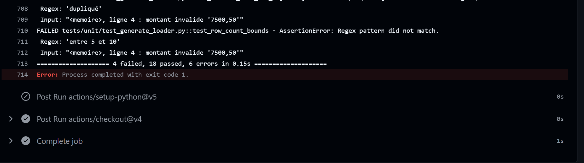

# Q6 / Q7 — Scénarios d'échec (captures d'écran)

Les captures se font sur GitHub, dans l'onglet **Actions** du dépôt. Ranger les images
dans `docs/captures/` et les référencer dans ce fichier.

## Lancer un scénario

**Actions → CI → Run workflow**, puis choisir les options :

| Scénario | Option | Ce qui échoue | Message attendu |
|---|---|---|---|
| A. Bug de génération | `inject_bug = generation` | job *Lint + tests unitaires* | `InvalidCsvError: transactions_2026-01-01.csv, ligne 4 : montant invalide '7500,50'` |
| B. Bug de traitement (seuil) | `inject_bug = processing` | job *Lint + tests unitaires* | `test_flag_threshold_is_strict[5000.00-False]` et `test_process_flags_expected_transactions` (T002 flaggée à tort) |
| C. Bug de traitement (agrégat) | `inject_bug = aggregation` | job *Lint + tests unitaires* | `test_sum_received_by_iban`, `test_totals_are_consistent` |
| D. Panne d'insertion récupérée | `fail_insert_times = 2` | rien : ✅ vert | logs « tentative 1/3 échouée … réussi à la tentative 3/3 » |
| E. Panne d'insertion définitive | `fail_insert_times = 5` | étape *5. Traitement* | `échec définitif après 3 tentatives`, code retour 1 |
| F. Panne S3 récupérée (niveau 2) | `fail_download_times = 2` | rien : ✅ vert | logs « téléchargement … réussi à la tentative 3/3 » |
| G. Panne S3 définitive (niveau 2) | `fail_download_times = 3` | étape *5. Traitement* | `RetryError: téléchargement s3://… échec après 3 tentatives` |

Alternative sans bouton : créer une branche, lancer `python scripts/inject_bug.py
processing`, committer et pousser. La CI échoue sur cette branche. Pour annuler :
`git checkout -- src/`.

## Captures à faire

Pour chaque scénario, 2 captures suffisent :

1. la liste des runs (croix rouge ❌ vs coche verte ✅) ;
2. le détail de l'étape en échec avec le message d'erreur.

Pour les scénarios D et F, capturer les lignes `WARNING … tentative x/3 échouée` puis
`réussi à la tentative 3/3` dans l'étape *5. Traitement*, et l'étape *7. Vérification
des données en base* verte : la preuve qu'il n'y a pas de doublon après les retries.

## Reproduire en local (sans GitHub)

```bash
docker compose up -d --wait postgres s3
python -m txpipeline pipeline                    # état de référence

# Scénario A
python scripts/inject_bug.py generation
pytest tests/unit                                # -> échecs
git checkout -- src/                             # annuler

# Scénario E puis reprise
python -m txpipeline reset-db
FAIL_INSERT_TIMES=5 python -m txpipeline run     # -> échec, code 1, base vide
python -m txpipeline run                         # -> panne résolue, 3 fichiers traités
TXP_E2E=1 pytest tests/e2e                       # -> données exactes, aucun doublon
```

(Sous PowerShell : `$env:FAIL_INSERT_TIMES=5; python -m txpipeline run; Remove-Item Env:FAIL_INSERT_TIMES`.)

## Captures

<!-- Ajouter ici les images, par ex. :  -->
