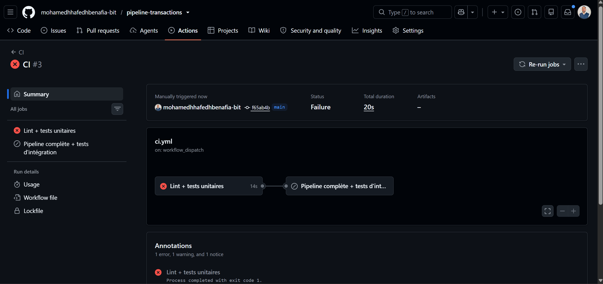
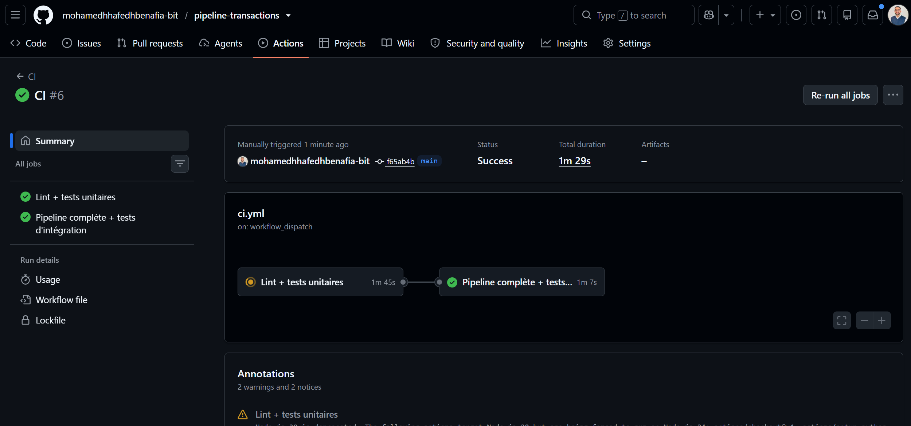

# Q6 / Q7 — Scénarios d'échec (captures d'écran)

Les captures se font sur GitHub, dans l'onglet **Actions** du dépôt. Ranger les images
dans `docs/captures/` et les référencer dans ce fichier.

## Lancer un scénario

**Actions → CI → Run workflow**, puis choisir les options :

| Scénario | Option | Ce qui échoue | Message attendu |
|---|---|---|---|
| A. Bug de génération | `inject_bug = generation` | job *Lint + tests unitaires* | `InvalidCsvError: transactions_2026-01-01.csv, ligne 4 : montant invalide '7500,50'` |
| B. Bug de traitement (seuil) | `inject_bug = processing` | job *Lint + tests unitaires* | `test_flag_threshold_is_strict[5000.00-False]` et `test_process_flags_expected_transactions` (T002 flaggée à tort) |
| C. Bug de traitement (agrégat) | `inject_bug = aggregation` | job *Lint + tests unitaires* | `test_sum_received_by_iban` (FR3, qui ne reçoit rien, apparaît) |
| D. Panne d'insertion récupérée | `fail_insert_times = 2` | rien : ✅ vert | logs « tentative 1/3 échouée … réussi à la tentative 3/3 » |
| E. Panne d'insertion définitive | `fail_insert_times = 5` | étape *5. Traitement* | `échec définitif après 3 tentatives`, code retour 1 |
| F. Panne S3 récupérée (niveau 2) | `fail_download_times = 2` | rien : ✅ vert | logs « téléchargement … réussi à la tentative 3/3 » |
| G. Panne S3 définitive (niveau 2) | `fail_download_times = 3` | étape *5. Traitement* | `RetryError: téléchargement s3://… échec après 3 tentatives` |

Alternative sans bouton : créer une branche, lancer `python scripts/inject_bug.py
processing`, committer et pousser. La CI échoue sur cette branche. Pour annuler :
`git checkout -- src/`.

Le sujet (Q6) demande **un** scénario d'échec : le scénario A est capturé ci-dessous.
Le scénario D illustre en plus le retry de Q7. Les autres restent disponibles pour une
démonstration.

## Reproduire en local (sans GitHub)

```bash
docker compose up -d --wait postgres s3
python -m txpipeline pipeline                    # état de référence

# Scénario A
python scripts/inject_bug.py generation
pytest tests/unit                                # -> échecs
git checkout -- src/                             # annuler

# Scénario E puis reprise
python -m txpipeline reset-db
FAIL_INSERT_TIMES=5 python -m txpipeline run     # -> échec, code 1, base vide
python -m txpipeline run                         # -> panne résolue, 3 fichiers traités
TXP_E2E=1 pytest tests/e2e                       # -> données exactes, aucun doublon
```

(Sous PowerShell : `$env:FAIL_INSERT_TIMES=5; python -m txpipeline run; Remove-Item Env:FAIL_INSERT_TIMES`.)

## Captures

### Scénario A — bug de génération (Q6) : la pipeline échoue ❌

Run CI lancé avec `inject_bug = generation` : un montant est écrit `7500,50` (virgule)
au lieu de `7500.50`. Le job *Lint + tests unitaires* échoue, le job *Pipeline
complète + tests d'intégration* est sauté et la CD n'est pas déclenchée : aucune
donnée corrompue n'atteint la base ni la production.



Détail de l'étape *Tests unitaires* : le chargeur rejette le fichier
(`ligne 4 : montant invalide '7500,50'`), `4 failed, 18 passed, 6 errors`, code retour 1.


### Scénario D — panne d'insertion récupérée par le retry (Q7) : la pipeline réussit ✅

Run CI lancé avec `fail_insert_times = 2` : chaque fichier voit son insertion échouer
deux fois (après une insertion partielle), puis réussir à la 3ᵉ tentative. Les deux
jobs sont verts, y compris l'étape *7. Vérification des données en base* : les
retries n'ont laissé ni donnée partielle ni doublon.


